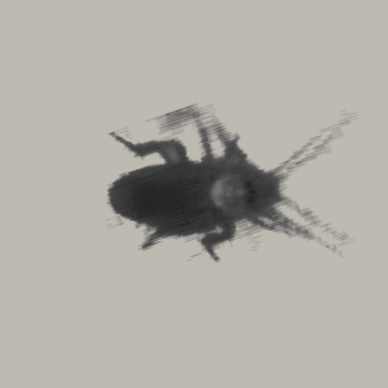
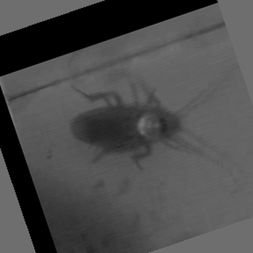

# 真實蟑螂爬行影格：剪裁與去背預覽

[直接播放實拍去背版](real/real-crawl.gif?raw=true)

## 原始畫面裁切對照

[開啟裁切對照](real/real-source-comparison.gif?raw=true)

- [透明 WebP，24 FPS](real/real-crawl.webp?raw=true)
- [MP4，24 FPS](real/real-crawl.mp4?raw=true)

### 製作方式與限制

直接從真實美洲大蠊影片取出連續影格，追蹤身體、轉成朝右、裁切並去背，沒有生成新的腿或動作。去背試版選用原片第 28–36 幀，9 幀循環 375ms，平均 24 FPS；MP4 同樣為 24 FPS。GIF 重複兩次循環以分配格式的 10ms 時間精度。原始裁切對照保留 25 FPS。

來源影片本來就是 10 倍慢放的段落，輸出沒有冒稱真實原速。來源只有 432×748，蟑螂只佔畫面一小部分；目前是低解析度灰階動作試片，仍有模糊、去背軟邊、部分細觸鬚遺失與近似循環接縫。要做清晰彩色的最終素材，需要更好的近距離原片。

### 來源、作者與授權

Mongeau J-M et al. (2012), *Rapid Inversion: Running Animals and Robots Swing like a Pendulum under Ledges*, PLOS ONE 7(6): e38003, Video S1.

- [原始論文與影片](https://journals.plos.org/plosone/article?id=10.1371/journal.pone.0038003)
- [Wikimedia Commons 來源檔](https://commons.wikimedia.org/wiki/File:Periplaneta_americana_performing_a_high-speed_inversion_on_a_ramp_(top_view)_-_Journal.pone.0038003.s001.ogv)
- 原影片依 [CC BY 2.5](https://creativecommons.org/licenses/by/2.5/) 使用；本預覽做了追蹤、旋轉、裁切、去背、邊緣處理、1.5 倍空間放大與 25 至 24 FPS 播放調整。原作者不代表認可此衍生版本。
