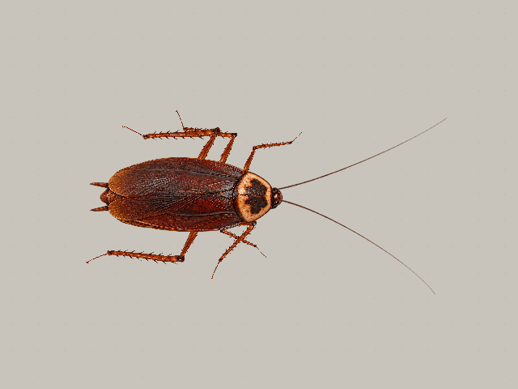

# 蟑螂爬行動畫：完全俯視版

## 一般速度（24 FPS）

[直接開啟一般速度動畫](topdown/topdown-preview.gif?raw=true)

## 慢放檢查腳步

[直接開啟慢放動畫](topdown/topdown-slow.gif?raw=true)

## 影片與透明素材

- [向前行走 MP4](topdown/topdown-forward.mp4?raw=true)
- [一般速度 MP4](topdown/topdown-crawl.mp4?raw=true)
- [透明循環 WebP](topdown/topdown-crawl.webp?raw=true)

新版為完全俯視、每秒 24 幀。以固定紋理肢段與關節運算重做，使用兩組交替三足支撐，包含著地向後推進與抬腳回收。預覽的地面點跟隨鏡頭移動，可用來檢查腳底是否滑動；另提供固定鏡頭的向前行走影片。

動作參考：Mongeau et al. (2012), [Rapid Inversion: Running Animals and Robots Swing like a Pendulum under Ledges, Video S1](https://journals.plos.org/plosone/article?id=10.1371/journal.pone.0038003)。已檢視實拍影片分幀，採用起跑踏步部分作定性參考，不模擬翻越平台的動作。

這仍是參考步態後建立的 2D 關節動畫，不是從實拍影片直接擷取的動作捕捉。模型設定步頻 4 Hz，支撐期比例 0.62；驗證每個時刻至少三足支撐、著地不滑動及腿節長度固定。這些數值是模型檢查，不代表擬真程度已經獲得實驗驗證。

一般循環 48 幀／2 秒；慢放 96 幀／4 秒，兩者均為 24 FPS。渲染原始碼與驗證資料保存在 topdown 子目錄。前一版生成姿勢補幀動畫不作為新版預覽。
