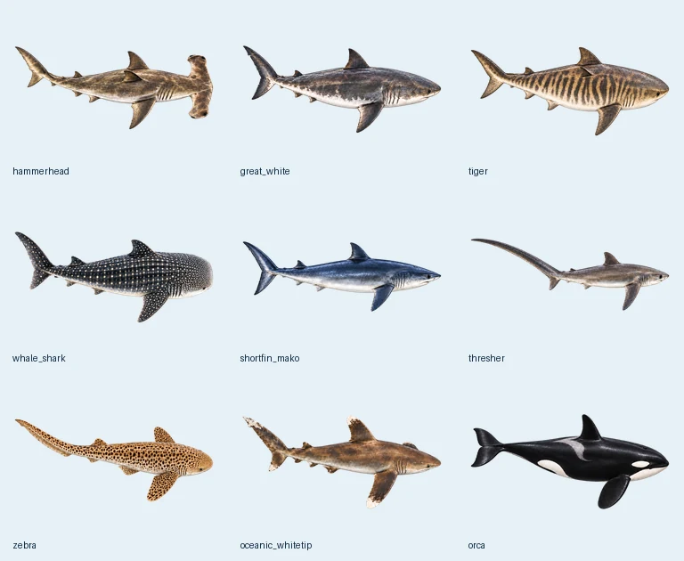

# 寫實彩色素材（1.2）

使用者已審核八種鯊魚及虎鯨的彩色設計，並於 2026-10-29 明確要求全部替換原本黑白素材。



替換雙髻鯊、大白鯊、虎鯊、鯨鯊、尖吻鯖鯊、長尾鯊、豹紋鯊、遠洋白鰭鯊及虎鯨；虎鯨保留真實黑白體色與灰色鞍斑。五種魟魚維持已確認的彩色版本。

素材為 512×512 無損透明 WebP，按物種共用，不因魚數增加複製。九種各有一張姿勢，沿用既有連續網格擺尾、轉彎及時間控制。雙髻鯊直游與左右轉彎使用同一張彩色姿勢與現有 HammerheadMotion，已移除舊黑白轉彎圖集及未使用的原始動畫，避免轉彎切回灰階。全部十四種解碼像素合計 14 MiB。

物種 ID、已保存清單、大小、速度、互動、特效、搖動與總上限 50 隻不變。預覽、桌面與清單縮圖共用同一份素材。

重新打包：提供三張已去背且各有三列生物的 PNG，依次為雙髻鯊／大白鯊／虎鯊、鯨鯊／尖吻鯖鯊／長尾鯊、豹紋鯊／遠洋白鰭鯊／虎鯨。

```sh
python -m pip install Pillow numpy scipy
python tools/prepare_color_poses.py plate-a.png plate-b.png plate-c.png
python tools/check_species_assets.py
```

姿勢按頭部中心對齊旋轉軸，保留完整長尾、白色腹部及白色斑紋。資產檢查驗證透明邊界、尺寸、週期及不存在殘留黑白 WebP；Android 介面測試驗證九種彩色姿勢可解碼且左右轉彎都回用同一份素材。

真實體色參考：
- [佛羅里達自然史博物館：尖吻鯖鯊](https://www.floridamuseum.ufl.edu/discover-fish/species-profiles/shortfin-mako/)
- [佛羅里達自然史博物館：豹紋鯊](https://www.floridamuseum.ufl.edu/discover-fish/species-profiles/stegostoma-fasciatum/)
- [NOAA：遠洋白鰭鯊辨識](https://www.fisheries.noaa.gov/resource/outreach-materials/oceanic-whitetip-shark-identification-guide)
- [NOAA：虎鯨](https://www.fisheries.noaa.gov/species/killer-whale)
